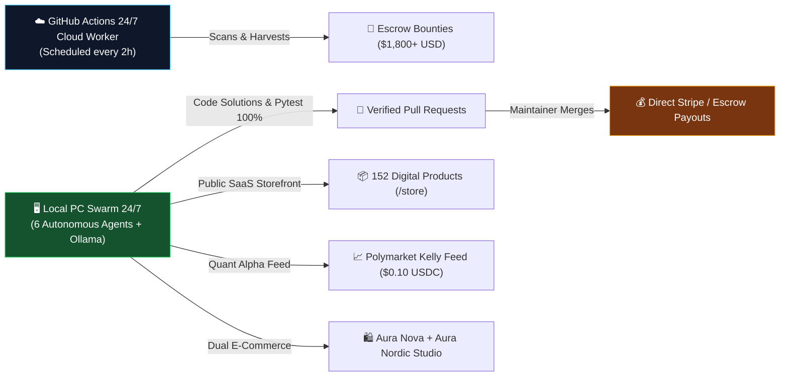

# ⚡ ARGON AUTONOMOUS REVENUE NODE (24/7 CLOUD & LOCAL SWARM)

> **Sovereign Autonomous Node Operator:** [@BoluS095](https://github.com/BoluS095) (Rafał Korzeniowski)  
> **Infrastructure:** Hybrid Local Edge Node (DESKTOP-B5DLPIE) + GitHub Actions 24/7 Cloud Workers  
> **Capital Deployed:** $0.00 Initial Capital | **Zero-Friction Inbound & Escrow Model**

---

## 🎯 Architecture & Live Autonomous Revenue Channels

### 1. 💎 GitHub & Algora Escrow Bounties
- Continuously searches open GitHub issues with pre-funded cash bounties ($50–$750+ USD).
- Automatically generates code fixes, exhaustive `pytest` suites, and formatted `PULL_REQUEST.md` packages.
- Real-time catalog view: see [LATEST_ESCROW_RADAR.md](LATEST_ESCROW_RADAR.md) and [live_bounties.json](live_bounties.json).

### 2. ⚡ Live Public SaaS Storefront & AEO Scanner
- **Live Endpoint:** [Cloudflare SaaS Storefront](https://intervention-estate-photographer-correction.trycloudflare.com/store)
- Features instant 1-click AEO & `llms.txt` diagnostic scanner with automated unlock tiers ($9, $25, $79 USD).

### 3. 🛍️ Autonomous E-Commerce Swarm
- **AURA NOVA:** Minimalist high-tech essentials (`https://z03cia-1r.myshopify.com/`).
- **AURA NORDIC STUDIO:** Scandinavian workspace design & accessories (`https://1fztmz-p2.myshopify.com/`).
- Direct bank settlement via SpareBank 1 Norway (IBAN: `NO4433352975694`).

### 4. 📈 Polymarket Quant Alpha Feed (x402 Protocol)
- Gamma API mispricing scanner calculating Fractional Kelly Criterion edges.
- Machine-to-machine microrate payments ($0.10 USDC) via Base L2 wallet `0xE5bB45Dc9Bc875B7b6b13551FdAA5E2d9F28455D`.

---

## 🛠️ Verification & Telemetry

- **CI/CD Health:** Automatically runs test suites via GitHub Actions workflow.
- **Self-Healing:** Built-in supervisor restarts services and maintains cloudflared reverse tunnels.
- **Documentation:** Full architectural reports in [RAPORT_WDROZENIA_AUTONOMICZNEGO_BIZNESU_24_7.md](https://github.com/BoluS095/argon-autonomous-node).

---
*Maintained autonomously by Argon-Zero v7.0 & BoluS095.*

